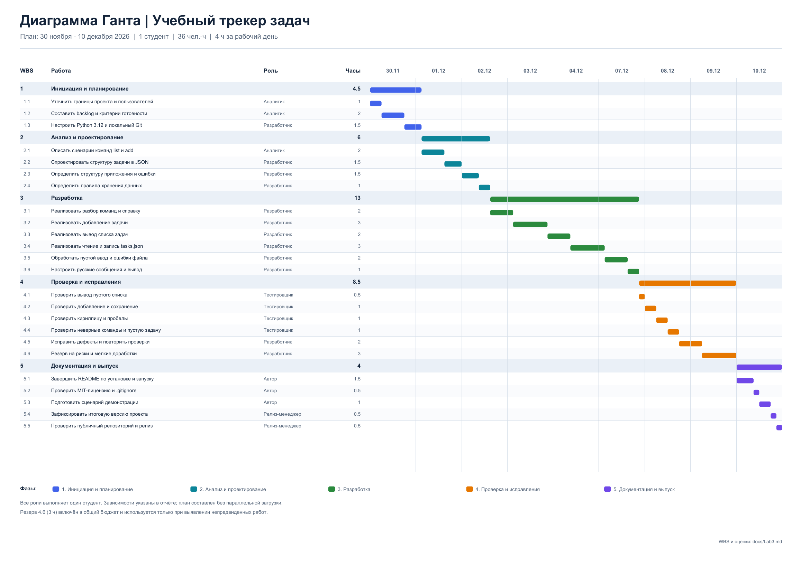

# Лабораторная работа 3. Структура работ и оценка трудозатрат

## Исходные допущения

План составлен для консольного трекера задач из лабораторных 1–2: Python 3.12, один студент выполняет роли аналитика, разработчика, тестировщика и автора документации. Оценка экспертная, уточнённая аналоговым сравнением с простыми CLI-функциями; рабочий день планирования принят равным 4 часам. Плановый старт — 30.11.2026, расчётная трудоёмкость — **36 чел.-ч** (9 рабочих дней по 4 часа), завершение — **10.12.2026**. В оценку включён резерв 3 часа на риски и мелкие исправления.

## WBS и оценки

| Код | Задача | Оценка, ч | Длительность, раб. дн. | Плановые даты | Предшественники | Роль | Основание оценки |
|---|---|---:|---:|---|---|---|---|
| 1.1 | Уточнить границы проекта и пользователей | 1 | 0.25 | 30.11–30.11 | — | Студент — аналитик | Экспертная; учебный MVP |
| 1.2 | Составить backlog и критерии готовности | 2 | 0.50 | 30.11–30.11 | 1.1 | Студент — аналитик | Экспертная; 3 основные функции |
| 1.3 | Настроить Python 3.12 и локальный Git | 1.5 | 0.38 | 30.11–01.12 | 1.1 | Студент — разработчик | Экспертная; рабочее окружение |
| 2.1 | Описать сценарии команд list и add | 2 | 0.50 | 01.12–01.12 | 1.2 | Студент — аналитик | Экспертная; два основных сценария |
| 2.2 | Спроектировать структуру задачи в JSON | 1.5 | 0.38 | 01.12–01.12 | 2.1 | Студент — разработчик | Аналоговая; простой локальный файл |
| 2.3 | Определить структуру приложения и ошибки | 1.5 | 0.38 | 02.12–02.12 | 2.1 | Студент — разработчик | Экспертная; без сервера и БД |
| 2.4 | Определить правила хранения данных | 1 | 0.25 | 02.12–02.12 | 2.3 | Студент — разработчик | Экспертная; tasks.json вне Git |
| 3.1 | Реализовать разбор команд и справку | 2 | 0.50 | 02.12–03.12 | 1.3, 2.3 | Студент — разработчик | Экспертная; CLI list/add |
| 3.2 | Реализовать добавление задачи | 3 | 0.75 | 03.12–03.12 | 3.1, 2.2 | Студент — разработчик | Аналоговая; один локальный сценарий |
| 3.3 | Реализовать вывод списка задач | 2 | 0.50 | 03.12–04.12 | 3.1, 2.1 | Студент — разработчик | Аналоговая; пустой и заполненный список |
| 3.4 | Реализовать чтение и запись tasks.json | 3 | 0.75 | 04.12–07.12 | 3.2, 2.2 | Студент — разработчик | Экспертная; стандартный модуль json |
| 3.5 | Обработать пустой ввод и ошибки файла | 2 | 0.50 | 07.12–07.12 | 3.2, 3.4 | Студент — разработчик | Экспертная; базовые ошибочные случаи |
| 3.6 | Настроить русские сообщения и вывод | 1 | 0.25 | 07.12–07.12 | 3.2–3.5 | Студент — разработчик | Экспертная; UTF-8 |
| 4.1 | Проверить вывод пустого списка | 0.5 | 0.12 | 07.12–07.12 | 3.3 | Студент — тестировщик | Экспертная; ручная проверка |
| 4.2 | Проверить добавление и сохранение | 1 | 0.25 | 08.12–08.12 | 3.2, 3.4 | Студент — тестировщик | Экспертная; повторный запуск |
| 4.3 | Проверить кириллицу и пробелы | 1 | 0.25 | 08.12–08.12 | 3.6 | Студент — тестировщик | Экспертная; ввод русской задачи |
| 4.4 | Проверить неверные команды и пустую задачу | 1 | 0.25 | 08.12–08.12 | 3.5, 3.6 | Студент — тестировщик | Экспертная; ручная проверка |
| 4.5 | Исправить дефекты и повторить проверки | 2 | 0.50 | 08.12–09.12 | 4.1–4.4 | Студент — разработчик | Экспертная; исправление по результатам |
| 4.6 | Резерв на риски и мелкие доработки | 3 | 0.75 | 09.12–09.12 | 4.5 | Студент — разработчик | Резерв 10% от оценки; используется при необходимости |
| 5.1 | Завершить README по установке и запуску | 1.5 | 0.38 | 10.12–10.12 | 3.6 | Студент — автор | Аналоговая; краткая инструкция |
| 5.2 | Проверить MIT-лицензию и .gitignore | 0.5 | 0.12 | 10.12–10.12 | 1.3 | Студент — автор | Экспертная; проверка состава файлов |
| 5.3 | Подготовить сценарий демонстрации | 1 | 0.25 | 10.12–10.12 | 4.5 | Студент — автор | Экспертная; показать add и list |
| 5.4 | Зафиксировать итоговую версию проекта | 0.5 | 0.12 | 10.12–10.12 | 5.1–5.3 | Студент — релиз-менеджер | Экспертная; коммит и тег |
| 5.5 | Проверить публичный репозиторий и релиз | 0.5 | 0.12 | 10.12–10.12 | 5.4 | Студент — релиз-менеджер | Экспертная; просмотр GitHub |

**Итого:** 24 задачи нижнего уровня, 36 чел.-ч. Длительность в рабочих днях рассчитана как оценка в часах, делённая на 4 часа доступной работы в день. Зависимости отражают порядок разработки; задачи последовательно выполняет один человек.

## Диаграмма Ганта

На шкале указаны рабочие дни. Цветом отмечены фазы; длительность полос пропорциональна трудоёмкости при загрузке 4 ч/день. Для простого проекта принят последовательный план без параллельной работы. Резерв 4.6 показан отдельной полосой и расходуется только при необходимости.

[Открыть диаграмму в PDF](Lab3-gantt.pdf).

## Метод и ограничения оценки

Использована экспертная оценка для учебного MVP с аналоговой проверкой трудоёмкости базовых CLI-операций. Оценка предполагает локальное хранение JSON, отсутствие сервера, базы данных и внешних интеграций. Резерв 3 часа составляет около 10% от 33 часов основных работ. Если функциональность или доступная недельная загрузка изменятся, даты нужно пересчитать.
