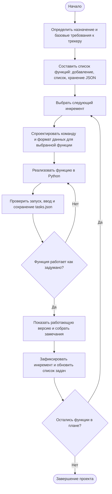

# Лабораторная работа 2. Выбор модели жизненного цикла

## Описание проекта

Учебный консольный трекер помогает студентам и начинающим разработчикам вести личные задачи без отдельного сервиса. Сейчас он позволяет добавлять задачи и просматривать список, сохраняя данные локально в `tasks.json`. В дальнейшем можно добавить отметку о выполнении, редактирование и удаление задач. Проект рассчитан на одного студента, Python 3.12 и около двух недель работы; сервер и внешние сервисы не используются, а требования могут уточняться по мере разработки.

## Сравнение моделей жизненного цикла

| Критерий | Каскадная | Спиральная | Инкрементная |
|---|---|---|---|
| Требования | Нужно определить почти все функции до начала разработки. | Уточняются в каждом цикле вместе с анализом рисков. | Базовые функции известны, остальные можно добавлять по частям. |
| Изменения | Поздние изменения приводят к возврату на предыдущие этапы. | Допускаются после оценки риска и пересмотра плана. | Включаются в следующий инкремент без переделки всего продукта. |
| Риски для этого проекта | Невысокие технические риски, но требования к удобству могут измениться. | Анализ рисков в каждом цикле создаёт лишнюю работу для небольшого учебного проекта. | Риски умеренные; каждую новую функцию можно проверить отдельно. |
| Команда и масштаб | Проще управлять большой командой и фиксированным объёмом работ. | Полезна для крупных и рискованных систем с ресурсами на анализ. | Подходит одному студенту и небольшому приложению. |
| Когда доступна польза | Рабочая программа появляется ближе к завершению этапов. | Промежуточный результат появляется после каждого витка. | После каждого инкремента остаётся запускаемая версия трекера. |
| Вовлечение пользователя | Достаточно согласовать требования в начале и принять готовый продукт. | Нужно регулярно обсуждать риски и результаты витка. | Пользователь может оценивать готовые функции и уточнять следующие. |
| Вывод для трекера | Возможна, но плохо учитывает уточнение функций по ходу работы. | Избыточна: риски и сложность проекта невелики. | Наиболее подходящая: даёт ранний результат и позволяет постепенно расширять функции. |

## Выбранная модель

Выбрана **инкрементная модель**. Она подходит небольшому индивидуальному проекту: базовый трекер можно оставить рабочим, а отметку выполнения, редактирование и удаление добавлять и показывать по отдельности. Такой порядок помогает быстро получать обратную связь и ограничивает объём изменений в каждой версии.

Каскадная модель менее удобна, потому что весь набор функций пришлось бы согласовать заранее, хотя детали пользовательского сценария ещё могут измениться. Спиральная модель не оправдывает затраты: проект не содержит существенных технических или финансовых рисков, требующих отдельного анализа в каждом цикле.

План работы: короткие инкременты примерно по 3–4 дня. В конце каждого инкремента запускается текущая версия, демонстрируются добавленные функции и уточняется следующий шаг. Сначала фиксируется базовая работа со списком задач и JSON-файлом, затем по очереди добавляются отметка выполнения, редактирование и удаление.

## Схема инкрементной разработки

